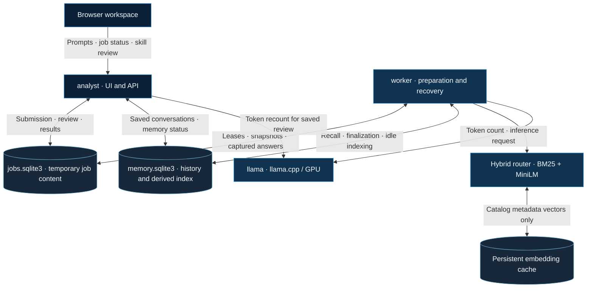

<p align="center">
  
</p>

<h2 align="center">Local-first DFIR analyst workspace</h2>

<p align="center">
  Evolving toward an agentic digital forensics and incident response analyst — reducing repetitive investigation work and shortening the path from incident intake to an evidence-backed triage report.
</p>

<p align="center">
  
  
  
  
</p>

<p align="center">
  <a href="#dfir-roadmap">DFIR roadmap</a> &nbsp;•&nbsp;
  <a href="#quick-start">Quick start</a> &nbsp;•&nbsp;
  <a href="#architecture">Architecture</a> &nbsp;•&nbsp;
  <a href="#configuration">Configuration</a> &nbsp;•&nbsp;
  <a href="#job-api">Job API</a> &nbsp;•&nbsp;
  <a href="#validation--limitations">Validation</a>
</p>

---

## Overview

**CORVEUS** is a local-first workspace for digital forensics and incident response (DFIR), evolving toward an **agentic analyst that takes repetitive investigation tasks off the operator's hands**. Its goal is to reduce the time from incident intake to a useful, evidence-backed triage report while keeping the operator in control of scope and sensitive actions.

**Today, CORVEUS is an interactive analyst assistant**, not an autonomous forensic investigator. It uses [llama.cpp](https://github.com/ggml-org/llama.cpp) to run **Phi-4-mini Q4_K_M**, and combines **BM25** with **MiniLM semantic similarity** to retrieve relevant cybersecurity guidance. Durable processing, optional conversation recall, and restart-aware indexing provide the foundation for future investigation workflows.

### Implemented capabilities

| Workspace capability | What it provides |
| :--- | :--- |
| **Analyst workspace** | Browser UI for prompts, results, job status, and skill review |
| **Hybrid skill routing** | Lexical + semantic retrieval with applicability and diversity checks |
| **Persistent embedding cache** | Reuses catalog metadata vectors across worker restarts; does not cache user prompts or answers |
| **Context-aware preparation** | Exact input-token counting and review of over-budget skill selections |
| **Durable job processing** | SQLite-backed queue, idempotent submissions, and restart-aware recovery |
| **Conversation modes** | Optional saved conversations and an Incognito mode without history saving |
| **Bounded conversation recall** | Opt-in retrieval of attributed historical excerpts, fitted to an explicit input-token allowance |
| **Resumable memory indexing** | Tokenizer-aware chunks, durable indexing work, bounded retries, and idle-time backfill |
| **Memory inspection** | Recall availability, indexing progress, and expandable source excerpts for new answers |
| **Local inference** | A dedicated llama.cpp GPU service, separate from the API and worker |

> [!IMPORTANT]
> **Supported Compose deployment:** Single-host beta targeting an **RTX 3060 Laptop GPU (6 GB VRAM)**, with **one inference at a time**. **Authentication is not implemented**; requests use one server-configured local principal, and the API is published on localhost only. GB10 validation is excluded. Multiuser fairness, long-context stress testing, and live timeout/cancellation fault testing remain outstanding.

## DFIR roadmap

The following capabilities are **planned, not implemented**. They describe the direction of the project, not features available in the current beta.

| Planned capability | Intended analyst benefit |
| :--- | :--- |
| **Case management and isolation** | Keep investigation scope, state, and evidence separate between cases |
| **Evidence intake and provenance** | Register artifacts, preserve originals, record hashes, and trace derived observations to their sources |
| **Controlled forensic tool execution** | Run allowlisted, read-only analysis through validated tool adapters rather than arbitrary commands |
| **Durable investigation workflows** | Resume multi-step investigations with recorded actions, explicit stopping conditions, and bounded resource use |
| **Routine triage automation** | Extract and deduplicate indicators, correlate events, and construct timelines |
| **Evidence-backed reporting** | Produce triage reports that distinguish observed facts, supported interpretations, hypotheses, and unresolved questions |
| **Operator approval gates** | Require explicit approval for sensitive or environment-changing actions |

The intended workflow is **incident intake → scoped investigation → evidence-linked findings → operator-reviewed triage report**. Initial automation should focus on read-only analysis of supplied evidence; live collection and response actions require separate controls and validation.

**Current autonomy boundary:** CORVEUS does not execute forensic tools, collect artifacts, contain systems, or autonomously investigate incidents. Retrieved skills are guidance, not execution permissions. Conversation memory is not a forensic evidence store, and its operator-level scope does not provide case isolation.

Progress will be measured against an operator baseline: **time to an acceptable triage report**, operator interventions, finding accuracy, evidence-reference coverage, and missed or false escalation. Faster output alone is not evidence of better triage; no DFIR productivity improvement has been established yet.

## Quick start

**Prerequisites:** Docker Compose with NVIDIA GPU support, the NVIDIA Container Toolkit, sufficient RAM and disk space, and access to the required model files and container images.

**1. Initialize the skills submodule** from the project root:

```bash
git submodule update --init --recursive
```

**2. Place the local models** in the expected layout:

```text
models/
├── Phi-4-mini-instruct-Q4_K_M.gguf
└── all-MiniLM-L6-v2/
```

Model files are not committed to Git. Obtain a compatible Phi-4-mini GGUF from a trusted publisher; the [official Phi-4-mini model page](https://huggingface.co/microsoft/Phi-4-mini-instruct) describes the base model. To download MiniLM from the project root, use a Python environment with `sentence-transformers` installed:

```bash
python3 download-emb-model.py
```

**3. Create your local configuration** on a new installation:

```bash
cp .env.example .env
```

Adjust `.env` to match your hardware and model paths.

**4. Build and launch:**

```bash
docker compose up --build -d
```

**5. Open the analyst workspace:** **[http://localhost:5000](http://localhost:5000)**

Only the UI/API port is published, and it is bound to localhost. The model is accessed through the Docker network. The worker exposes no listening endpoint or published port; it polls shared SQLite storage and calls the model over that network.

> [!NOTE]
> Downloading models and building uncached images requires network access. Once provisioned, the application loads its saved models locally. A complete air-gapped **installation** workflow is not provided.

---

## Architecture

The documented Compose deployment separates browser/API responsibilities, background job execution, and model inference into three Docker services.

Compose explicitly starts `service_entrypoint.py api` and `service_entrypoint.py worker`. The Dockerfile's default command still starts the legacy `http_server.py` entry point, which does not attach the durable job API. Running the image without Compose's command overrides does **not** provide the same pipeline; use the documented Compose startup.



| Service | Role |
| :--- | :--- |
| `analyst` | Browser UI, job API, conversation endpoints, and skill-review requests |
| `worker` | Skill routing, optional memory retrieval, prompt preparation, generation, result capture, recovery, and idle-time indexing |
| `llama` | GPU inference and exact input-token counting |

The API and worker share the **`analyst-data`** volume, with separate job and conversation databases and a catalog embedding-cache directory. The API does **not** load the embedding router or perform generation; it can call llama.cpp to recount a saved skill review. Separating generation from HTTP handling allows queued work to survive API restarts. HTTP requests are still handled serially.

### Request lifecycle

1. **Submit** — The browser sends a prompt with an idempotency key.
2. **Persist** — SQLite records the job and temporarily stores the prompt.
3. **Prepare and count** — The worker selects skills, loads their instructions, and obtains an authoritative count of the complete base messages. Eligible saved requests that fit without review may retrieve historical evidence; candidate messages are recounted while fitting excerpts. The exact resulting snapshot is then persisted.
4. **Review if necessary** — Requests whose selected skill instructions exceed the input budget pause. The user can remove skills, and the API recounts the saved preparation *without rerouting or adding new memory*. Requests that initially need review skip recall; a prompt that cannot fit without skills is rejected.
5. **Verify before dispatch** — The worker obtains an inference permit, recounts the complete saved messages, and revalidates the lease, cancellation state, and any historical evidence sources before calling the model.
6. **Generate and capture** — The worker calls the model once and durably captures the answer and normalized usage.
7. **Finalize** — Usage is recorded and the exchange is saved if requested.

Version checks prevent stale edits; leases identify the current worker attempt; and receipts prevent duplicate saved messages and usage when finalization is retried. SQLite handles transactions without requiring an additional database service.

**Source-supported database schemas:** Jobs **v7** · Conversations **v6**. Existing databases migrate on initialization; these versions do not establish the currently deployed database state.

### Model and retrieval design

| Component | Why it is used |
| :--- | :--- |
| **Phi-4-mini Q4_K_M** | Small enough for the hardware-constrained beta |
| **llama.cpp** | Local generation and authoritative input-token counting |
| **MiniLM on CPU** | Semantic skill matching without consuming generation VRAM |
| **BM25** | Exact-term matching for tools, techniques, and other lexical cues |
| **Applicability + diversity checks** | Reduce irrelevant and overlapping skill selections |
| **Bounded query views** | Help retrieve guidance from longer analyst prompts |

A request may select **zero skills** and still receive an answer. Retrieved skills are treated as **untrusted analytical guidance**: their scripts are not executed, their linked references are not automatically loaded, and their text cannot grant permissions.

The persistent cache stores **catalog metadata vectors only**, keyed to the model artifacts, encoding contract, dependencies, and ordered catalog metadata. It does not store prompts, query vectors, answers, or conversation memory. Query encoding still requires the local CPU model.

---

## Configuration

Settings are defined through `.env` and Compose environment substitutions. See [`.env.example`](.env.example) for router and memory options. Advanced job-setting validation lives in [`analyst/service_settings.py`](analyst/service_settings.py).

### Model, context, and memory

| Setting | Purpose / documented value |
| :--- | :--- |
| `LLAMA_IMAGE`, `MODEL_FILE`, `MODEL_NAME` | Inference image, GGUF filename, and model identifier |
| `LLM_CONTEXT_SIZE` | Context allocation; example **13,312** tokens |
| `LLM_MAX_OUTPUT_TOKENS` | Output reserve; example **1,024** tokens |
| `LLM_CONTEXT_SAFETY_MARGIN` | Extra reserve; example **512** tokens |
| `ROUTER_TOP_K` | Maximum skills selected; example **5** |
| `ROUTER_EMBEDDING_CACHE_ENABLED` | Persist catalog vectors between worker starts; defaults to **`true`** |
| `ROUTER_EMBEDDING_CACHE_DIR` | Cache directory; defaults to **`/app/data/router-embeddings`** |
| `MEMORY_ENABLED` | Conversation persistence; defaults to **`false`** |
| `MEMORY_RETRIEVAL_ENABLED` | Opt-in saved-history retrieval and worker indexing; defaults to **`false`** |
| `MEMORY_RETRIEVAL_TOKEN_BUDGET` | Incremental input-token allowance, including evidence wrappers; defaults to **512**; **0** disables new retrieval and indexing |
| `MEMORY_DATABASE_PATH` | Conversation database; defaults to **`/app/data/memory.sqlite3`** |
| `MEMORY_SCOPE` | Server-configured conversation partition |
| `MEMORY_RETENTION_DAYS` | Optional inactivity-based pruning; empty disables age-based pruning |

The input budget is calculated as:

```text
Input budget = Context size − Output reserve − Safety margin
```

CORVEUS uses exact prompt counting rather than character-based estimates. The memory reservation described below is an **admission-control accounting value**, not measured VRAM utilization or proof that a selected model/context fits on the GPU. Both application inference concurrency and llama.cpp parallel slots are fixed at **one** for this deployment.

### Job processing and retention

| Setting | Default / meaning |
| :--- | :--- |
| `SERVICE_MAX_WAITING_JOBS` | **16** globally waiting jobs |
| `SERVICE_OWNER_MAX_WAITING` | **4** waiting jobs per operator |
| `SERVICE_MAX_PENDING_REVIEWS` | **4** pending reviews |
| `SERVICE_JOB_DEADLINE_SECONDS` | **600 s** job deadline |
| `SERVICE_REVIEW_TTL_SECONDS` | **600 s** review allowance, capped by existing deadlines |
| `SERVICE_CONTENT_RETENTION_SECONDS` | **3,600 s** temporary prompt/answer retention |
| `SERVICE_INFERENCE_MEMORY_BUDGET_BYTES` | **6 GiB** admission accounting pool |
| `SERVICE_STOP_GRACE_PERIOD` | **300 s** container shutdown grace |

**Configuration notes:** Container paths in `.env.example` are container paths, not host paths. Shell environment variables may override Compose substitutions, and Compose only forwards settings defined in its environment block. When upgrading, preserve your existing `.env`; the example file is a reference, not something Compose automatically loads alongside `.env`.

## Operations and updates

Check service health and follow logs:

```bash
docker compose ps
docker compose logs -f analyst worker llama
```

The worker waits for model readiness before claiming jobs. In the UI, **Skill Router** readiness comes from a worker heartbeat updated every **5 seconds** and considered stale after **20 seconds**. This is separate from model health, and an Online indicator does not confirm that an earlier inference call has stopped.

Application code, skills, web assets, and MiniLM are copied into the image. After changing them, rebuild and recreate the application services:

```bash
docker compose build analyst
docker compose up -d --no-deps analyst worker
```

To stop the stack:

```bash
docker compose down
```

The `analyst-data` volume survives a normal `docker compose down`. Running **`docker compose down -v` deletes that volume**, including saved jobs and conversations. Before upgrading, back up both databases using SQLite's backup API; copying a live SQLite file can omit changes still held in its WAL.

---

## Conversations and privacy

| Mode | Behavior |
| :--- | :--- |
| **Saved** | Available when conversation storage is enabled; prompts for a conversation name, with search, reopen, rename, and delete controls |
| **Incognito** | Does not write exchanges to conversation history; the mode used for new installations when storage is disabled |

> [!WARNING]
> **Incognito is not zero-retention.** Prompts and answers still persist **temporarily in the job database**, even when history saving is disabled. Both modes follow the same content-retention policy.

Retries and skill review do not extend retention or resurrect expired content. The worker periodically removes expired requests and related snapshots/results; expiry is also checked when content is read. This is **application-level retention**. Neither backups nor SQLite storage are secure-erasure mechanisms.

Deleting a saved conversation removes its messages and derived chunks, terms, vectors, indexing work, and receipts through database cascades. Historical excerpts already copied into temporary job preparations are removed separately by bounded worker cleanup or temporary-content expiry; this is **not synchronous erasure of every copy**. Dispatch checks reject invalid historical sources, but deletion after the last check cannot retract an upstream model call or remove claims from an existing answer. Cleanup runs between jobs, so a long-running call can delay it. Backups retain their own lifecycle.

### Optional conversation recall

Conversation recall is **off by default for new installations**. It requires enabled conversation persistence, `MEMORY_RETRIEVAL_ENABLED=true`, and a positive retrieval budget. Opted-in workers enqueue new saved exchanges and discover existing history in bounded idle passes. Initial recall may be partial until backfill catches up, and sustained generation can delay indexing.

For saved requests, eligible excerpts can come from **other conversations in the same configured operator scope**, not only the active conversation. Retrieval does not replay the full chat history. Selected excerpts retain attribution and are presented to the model as untrusted historical data, not verified facts or higher-priority instructions. Incognito neither retrieves saved history nor saves an exchange.

`MEMORY_RETRIEVAL_TOKEN_BUDGET` limits the incremental input cost (default **512**, including evidence wrappers). Whole lower-ranked excerpts are omitted until the measured input fits both that allowance and the model context budget. A zero budget disables new retrieval and indexing. Recall does not establish case isolation, forensic provenance, or resistance to every prompt injection.

**Known recall limit:** The job API allows up to **200,000 prompt characters** by default, but memory retrieval accepts at most **16,000 query characters**. Saved preparation passes the full prompt to retrieval. With recall enabled, a prompt above that recall limit that otherwise fits the model budget and needs no skill review can fail preparation instead of proceeding without memory. Disabling recall or shortening the prompt avoids this path; authoritative model-context limits still apply.

**Recorded local validation:** Automatic enqueueing, indexing, and worker evidence preparation passed synthetic live recall/deletion, token-count, restart, and browser Incognito checks in the October 29, 2026 local release record. Broader relevance, realistic history-scale performance, and fault testing remain pending; these checks do not establish DFIR investigation accuracy or the state of a different deployment.

**Usage and browser state:** Usage totals represent completed exchanges. The UI's context comparison references cumulative tokens; it does not represent current prompt occupancy or an enforced quota. Browser request state remains in the tab rather than browser storage: closing the tab loses local tracking **but does not cancel** the server-side job.

## Job API

The API uses **one configured local operator**. Client requests cannot select tenants, owners, model profiles, or inference reservations.

| Method | Endpoint | Description |
| :--- | :--- | :--- |
| `GET` | `/v1/job-capabilities` | Discover whether the job API is attached |
| `POST` | `/v1/jobs` | Submit using an `Idempotency-Key` header |
| `GET` | `/v1/jobs/<id>` | Read status and version |
| `GET` | `/v1/jobs/<id>/review` | Read skill metadata and review deadline |
| `POST` | `/v1/jobs/<id>/review` | Remove skills via `expected_version` and `remove_skill_names` |
| `POST` | `/v1/jobs/<id>/cancel` | Request cancellation via `expected_version` |
| `GET` | `/v1/jobs/<id>/result` | Read completed answer, usage, and persistence outcome |
| `GET` | `/v1/status` | Read API, worker/router, model, and storage status |
| `GET` | `/v1/memory/status` | Read scoped recall availability and indexing counts |

### Example request

```bash
curl http://localhost:5000/v1/jobs -H 'Content-Type: application/json' -H 'Idempotency-Key: example-request-001' -d '{"prompt":"Explain suspicious Windows login patterns."}'
```

Successful submission returns **HTTP 202** and a job ID. Poll the job status, then request the result. To retry an uncertain submission, reuse the **same key and exact payload**; changing the payload with the same key produces a conflict. Saved requests also include a `conversation_id`, created using `POST /v1/conversations`.

The Memory inspector shows recall availability and indexing progress. New answers can display expandable, revalidated source excerpts and links to their saved conversations. Recall is server-configured; Incognito excludes saved memory. Source details are temporary request metadata, not a permanent citation log.

The conversation API supports listing, creation, messages, usage, rename, and deletion. While the job API is attached, legacy `/v1/chat/completions` and `/v1/chat/selection` routes are blocked to prevent bypassing inference admission.

### Cancellation and recovery guarantees

- **Queued/preparing:** Cancellation prevents generation.
- **Running:** Cancellation records the request, but capacity stays reserved until the model call is confirmed stopped. Shutdown tries to drain synchronous work and renew its lease.
- **Timeout or lost worker:** An uncertain attempt remains **interrupted**, retaining its inference reservation; it is **never automatically rerun**. Releasing the hold requires trusted upstream verification through internal reconciliation. A worker restart or Online indicator does not satisfy that requirement.
- **After answer capture:** Finalization can resume without repeating inference; receipts protect against duplicated conversation entries and usage across database commits.
- **Before durable capture:** A lost answer cannot be reconstructed without new generation, which the worker will not automatically attempt.

---

## Validation & limitations

**Recorded validation on the RTX 3060 deployment:**

These are historical local deployment checks, not results inferred from source inspection or a current health guarantee. Detailed local release records are not included in the published repository. Capability descriptions refer to the implementation in this checkout; reproducing them requires a source revision containing the memory retrieval, indexing, embedding-cache, configuration, and test changes together. Earlier published revisions may lack those changes.

- [x] Real inference on small prompts
- [x] Idempotent job submission
- [x] Saved-message and usage accounting
- [x] Persistence across restarts
- [x] Browser job submission
- [x] Local deployment and synthetic live validation of conversational memory recall

**Still outstanding:**

- [ ] Live timeout/cancellation fault injection
- [ ] Long-context stress testing
- [ ] Implement authentication and validate multiuser fairness before wider exposure
- [ ] Complete air-gapped installation instructions
- [ ] Realistic history-scale memory retrieval and indexing performance
- [ ] Align memory-query and job-prompt limits or provide safe memory-free fallback
- [ ] End-to-end DFIR workflow accuracy and operator-time benchmarks

This is a **single-host local beta**. The HTTP server processes requests serially.

### Regression tests

From a local Python environment with the project dependencies installed (and Node.js for the UI test):

```bash
PYTHONPATH=analyst python3 -m unittest discover -s tests -p 'test_service_*.py'
PYTHONPATH=analyst python3 -m unittest discover -s tests -p 'test_memory_*.py'
PYTHONPATH=analyst python3 -m unittest discover -s tests -p 'test_analyst_generation.py'
PYTHONPATH=analyst python3 -m unittest discover -s tests -p 'test_component_status.py'
PYTHONPATH=analyst python3 -m unittest discover -s tests -p '*router*.py'
node tests/test_workspace_ui.cjs
```

Tests use controlled counters, model callbacks, and isolated storage to check lifecycle and retrieval behavior. Passing unit tests does not establish live cancellation behavior, GPU/context fitness, browser layout, or investigative answer quality.

Source entry points for further inspection:

- [Worker startup and maintenance](analyst/service_entrypoint.py): process roles, optional recall wiring, idle indexing, and cleanup.
- [Prompt preparation](analyst/analyst_preparation.py): exact message budgets and attributed historical evidence.
- [Conversation storage](analyst/memory_store.py): migrations, scoped exchanges, usage, and retry receipts.
- [Skill router evaluation](analyst/router_evaluation.py): synthetic routing cases and offline measurements.
- [Memory manager tests](tests/test_memory_manager.py): optional persistence, scope isolation, deletion, forwarding, and retention boundaries.

Additional retrieval coverage is in `tests/test_memory_retrieval.py` (ranking and eligibility), `tests/test_memory_retrieval_preparation.py` (prompt fitting and worker dispatch), and `tests/test_memory_ui_api.py` (status counts and revalidated source metadata). These suites are included by the memory regression command above.

## Acknowledgments and licensing

CORVEUS's skills catalog is the [Anthropic Cybersecurity Skills](https://github.com/mukul975/Anthropic-Cybersecurity-Skills) Git submodule. The parent repository pins a specific commit for repeatable checkouts; uncommitted local changes inside the submodule are not captured by commits to the parent repository.

Additional technologies include [llama.cpp](https://github.com/ggml-org/llama.cpp), [Microsoft Phi-4-mini](https://huggingface.co/microsoft/Phi-4-mini-instruct), [all-MiniLM-L6-v2](https://huggingface.co/sentence-transformers/all-MiniLM-L6-v2), and [uv](https://github.com/astral-sh/uv). The application image uses **Python 3.12**, **uv**, and **CPU-only PyTorch**. Review each upstream project's license and model-use terms.

---

<p align="center">
  <strong>CORVEUS</strong><br />
  <sub>Build · Automate · Empower</sub>
</p>
