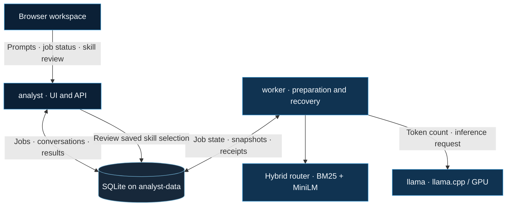

<p align="center">
  
</p>

<h2 align="center">Local-first cybersecurity analysis workspace</h2>

<p align="center">
  A browser-based assistant combining local language-model inference, hybrid cybersecurity skill retrieval, and durable job processing.
</p>

<p align="center">
  
  
  
  
</p>

<p align="center">
  <a href="#quick-start">Quick start</a> &nbsp;•&nbsp;
  <a href="#architecture">Architecture</a> &nbsp;•&nbsp;
  <a href="#configuration">Configuration</a> &nbsp;•&nbsp;
  <a href="#job-api">Job API</a> &nbsp;•&nbsp;
  <a href="#validation--limitations">Validation</a>
</p>

---

## Overview

**CORVEUS** is a local cybersecurity assistant designed for an interactive analyst workflow. It uses [llama.cpp](https://github.com/ggml-org/llama.cpp) to run **Phi-4-mini Q4_K_M**, and combines **BM25** with **MiniLM semantic similarity** to retrieve relevant cybersecurity guidance.

| Workspace capability | What it provides |
| :--- | :--- |
| **Analyst workspace** | Browser UI for prompts, results, job status, and skill review |
| **Hybrid skill routing** | Lexical + semantic retrieval with applicability and diversity checks |
| **Context-aware preparation** | Exact input-token counting and review of over-budget skill selections |
| **Durable job processing** | SQLite-backed queue, idempotent submissions, and restart-aware recovery |
| **Conversation modes** | Optional saved conversations and an Incognito mode without history saving |
| **Local inference** | A dedicated llama.cpp GPU service, separate from the API and worker |

> [!IMPORTANT]
> **Current deployment:** Single-host beta targeting an **RTX 3060 Laptop GPU (6 GB VRAM)**, with **one inference at a time**. GB10 validation is excluded. Authentication, multiuser fairness, long-context stress testing, and live timeout/cancellation fault testing are not yet complete.

## Quick start

**Prerequisites:** Docker Compose with NVIDIA GPU support, the NVIDIA Container Toolkit, sufficient RAM and disk space, and access to the required model files and container images.

**1. Initialize the skills submodule** from the project root:

```bash
git submodule update --init --recursive
```

**2. Place the local models** in the expected layout:

```text
models/
├── Phi-4-mini-instruct-Q4_K_M.gguf
└── all-MiniLM-L6-v2/
```

Model files are not committed to Git. Obtain a compatible Phi-4-mini GGUF from a trusted publisher; the [official Phi-4-mini model page](https://huggingface.co/microsoft/Phi-4-mini-instruct) describes the base model. To download MiniLM from the project root, use a Python environment with `sentence-transformers` installed:

```bash
python3 download-emb-model.py
```

**3. Create your local configuration** on a new installation:

```bash
cp .env.example .env
```

Adjust `.env` to match your hardware and model paths.

**4. Build and launch:**

```bash
docker compose up --build -d
```

**5. Open the analyst workspace:** **[http://localhost:5000](http://localhost:5000)**

Only the UI/API port is published, and it is bound to localhost. The model and worker remain reachable within the Docker network.

> [!NOTE]
> Downloading models and building uncached images requires network access. Once provisioned, the application loads its saved models locally. A complete air-gapped **installation** workflow is not provided.

---

## Architecture

CORVEUS separates browser/API responsibilities, background job execution, and model inference into three Docker services.



| Service | Role |
| :--- | :--- |
| `analyst` | Browser UI, job API, conversation endpoints, and skill-review requests |
| `worker` | Skill routing, prompt preparation, generation, result capture, and recovery |
| `llama` | GPU inference and exact input-token counting |

The API and worker share the **`analyst-data`** volume. The API does **not** load the embedding router or perform generation. This keeps browser requests responsive and allows queued work to survive API restarts.

### Request lifecycle

1. **Submit** — The browser sends a prompt with an idempotency key.
2. **Persist** — SQLite records the job and temporarily stores the prompt.
3. **Prepare** — The worker retrieves relevant skills and persists the exact preparation snapshot.
4. **Count** — llama.cpp measures the complete input, including skill instructions.
5. **Review if necessary** — Over-budget requests pause; the user can remove skills, and the API recounts saved instructions *without rerouting*.
6. **Generate** — The worker obtains an inference permit, calls the model once, and captures the answer.
7. **Finalize** — Usage is recorded and the exchange is saved if requested.

Version checks prevent stale edits; leases identify the current worker attempt; and receipts prevent duplicate saved messages and usage when finalization is retried. SQLite handles transactions without requiring an additional database service.

**Current database schemas:** Jobs **v6** · Conversations **v4**.

### Model and retrieval design

| Component | Why it is used |
| :--- | :--- |
| **Phi-4-mini Q4_K_M** | Small enough for the hardware-constrained beta |
| **llama.cpp** | Local generation and authoritative input-token counting |
| **MiniLM on CPU** | Semantic skill matching without consuming generation VRAM |
| **BM25** | Exact-term matching for tools, techniques, and other lexical cues |
| **Applicability + diversity checks** | Reduce irrelevant and overlapping skill selections |
| **Bounded query views** | Help retrieve guidance from longer analyst prompts |

A request may select **zero skills** and still receive an answer. Retrieved skills are treated as **untrusted analytical guidance**: their scripts are not executed, their linked references are not automatically loaded, and their text cannot grant permissions.

---

## Configuration

Settings are defined through `.env` and Compose environment substitutions. See [`.env.example`](.env.example) for router and memory options. Advanced job-setting validation lives in [`analyst/service_settings.py`](analyst/service_settings.py).

### Model, context, and memory

| Setting | Purpose / documented value |
| :--- | :--- |
| `LLAMA_IMAGE`, `MODEL_FILE`, `MODEL_NAME` | Inference image, GGUF filename, and model identifier |
| `LLM_CONTEXT_SIZE` | Context allocation; example **13,312** tokens |
| `LLM_MAX_OUTPUT_TOKENS` | Output reserve; example **1,024** tokens |
| `LLM_CONTEXT_SAFETY_MARGIN` | Extra reserve; example **512** tokens |
| `ROUTER_TOP_K` | Maximum skills selected; example **5** |
| `MEMORY_ENABLED` | Conversation persistence; defaults to **`false`** |
| `MEMORY_SCOPE` | Server-configured conversation partition |

The input budget is calculated as:

```text
Input budget = Context size − Output reserve − Safety margin
```

CORVEUS uses exact prompt counting rather than character-based estimates. The memory reservation described below is an **admission-control accounting value**, not measured VRAM utilization or proof that a selected model/context fits on the GPU. Both application inference concurrency and llama.cpp parallel slots are fixed at **one** for this deployment.

### Job processing and retention

| Setting | Default / meaning |
| :--- | :--- |
| `SERVICE_MAX_WAITING_JOBS` | **16** globally waiting jobs |
| `SERVICE_OWNER_MAX_WAITING` | **4** waiting jobs per operator |
| `SERVICE_MAX_PENDING_REVIEWS` | **4** pending reviews |
| `SERVICE_JOB_DEADLINE_SECONDS` | **600 s** job deadline |
| `SERVICE_REVIEW_TTL_SECONDS` | **600 s** review allowance, capped by existing deadlines |
| `SERVICE_CONTENT_RETENTION_SECONDS` | **3,600 s** temporary prompt/answer retention |
| `SERVICE_INFERENCE_MEMORY_BUDGET_BYTES` | **6 GiB** admission accounting pool |
| `SERVICE_STOP_GRACE_PERIOD` | **300 s** container shutdown grace |

**Configuration notes:** Container paths in `.env.example` are container paths, not host paths. Shell environment variables may override Compose substitutions, and Compose only forwards settings defined in its environment block. When upgrading, preserve your existing `.env`; the example file is a reference, not something Compose automatically loads alongside `.env`.

## Operations and updates

Check service health and follow logs:

```bash
docker compose ps
docker compose logs -f analyst worker llama
```

The worker waits for model readiness before claiming jobs. In the UI, **Skill Router** readiness comes from a worker heartbeat updated every **5 seconds** and considered stale after **20 seconds**. This is separate from model health, and an Online indicator does not confirm that an earlier inference call has stopped.

Application code, skills, web assets, and MiniLM are copied into the image. After changing them, rebuild and recreate the application services:

```bash
docker compose build analyst
docker compose up -d --no-deps analyst worker
```

To stop the stack:

```bash
docker compose down
```

The `analyst-data` volume survives a normal `docker compose down`. Running **`docker compose down -v` deletes that volume**, including saved jobs and conversations. Before upgrading, back up both databases using SQLite's backup API; copying a live SQLite file can omit changes still held in its WAL.

---

## Conversations and privacy

| Mode | Behavior |
| :--- | :--- |
| **Saved** | Available when conversation storage is enabled; prompts for a conversation name, with search, reopen, rename, and delete controls |
| **Incognito** | Does not write exchanges to conversation history; the mode used for new installations when storage is disabled |

> [!WARNING]
> **Incognito is not zero-retention.** Prompts and answers still persist **temporarily in the job database**, even when history saving is disabled. Both modes follow the same content-retention policy.

Retries and skill review do not extend retention or resurrect expired content. The worker periodically removes expired requests and related snapshots/results; expiry is also checked when content is read. This is **application-level retention**. Neither backups nor SQLite storage are secure-erasure mechanisms.

**Current limitations:** Conversation history is displayed but **not yet used for model recall**. Usage totals represent completed exchanges. The UI's context comparison references cumulative tokens; it does not represent current prompt occupancy or an enforced quota. Browser request state remains in the tab rather than browser storage: closing the tab loses local tracking **but does not cancel** the server-side job.

## Job API

The API uses **one configured local operator**. Client requests cannot select tenants, owners, model profiles, or inference reservations.

| Method | Endpoint | Description |
| :--- | :--- | :--- |
| `GET` | `/v1/job-capabilities` | Discover whether the job API is attached |
| `POST` | `/v1/jobs` | Submit using an `Idempotency-Key` header |
| `GET` | `/v1/jobs/<id>` | Read status and version |
| `GET` | `/v1/jobs/<id>/review` | Read skill metadata and review deadline |
| `POST` | `/v1/jobs/<id>/review` | Remove skills via `expected_version` and `remove_skill_names` |
| `POST` | `/v1/jobs/<id>/cancel` | Request cancellation via `expected_version` |
| `GET` | `/v1/jobs/<id>/result` | Read completed answer, usage, and persistence outcome |
| `GET` | `/v1/status` | Read API, worker/router, model, and storage status |

### Example request

```bash
curl http://localhost:5000/v1/jobs -H 'Content-Type: application/json' -H 'Idempotency-Key: example-request-001' -d '{"prompt":"Explain suspicious Windows login patterns."}'
```

Successful submission returns **HTTP 202** and a job ID. Poll the job status, then request the result. To retry an uncertain submission, reuse the **same key and exact payload**; changing the payload with the same key produces a conflict. Saved requests also include a `conversation_id`, created using `POST /v1/conversations`.

The conversation API supports listing, creation, messages, usage, rename, and deletion. While the job API is attached, legacy `/v1/chat/completions` and `/v1/chat/selection` routes are blocked to prevent bypassing inference admission.

### Cancellation and recovery guarantees

- **Queued/preparing:** Cancellation prevents generation.
- **Running:** Cancellation records the request, but capacity stays reserved until the model call is confirmed stopped. Shutdown tries to drain synchronous work and renew its lease.
- **Timeout or lost worker:** An uncertain attempt remains **interrupted**, retaining its inference reservation; it is **never automatically rerun**. Releasing the hold requires trusted upstream verification through internal reconciliation. A worker restart or Online indicator does not satisfy that requirement.
- **After answer capture:** Finalization can resume without repeating inference; receipts protect against duplicated conversation entries and usage across database commits.
- **Before durable capture:** A lost answer cannot be reconstructed without new generation, which the worker will not automatically attempt.

---

## Validation & limitations

**Validated on the RTX 3060 deployment:**

- [x] Real inference on small prompts
- [x] Idempotent job submission
- [x] Saved-message and usage accounting
- [x] Persistence across restarts
- [x] Browser job submission

**Still outstanding:**

- [ ] Live timeout/cancellation fault injection
- [ ] Long-context stress testing
- [ ] Authentication and multiuser fairness before wider exposure
- [ ] Complete air-gapped installation instructions
- [ ] Conversation-history recall in inference

This is a **single-host local beta**. The HTTP server processes requests serially.

### Regression tests

From a local Python environment with the project dependencies installed (and Node.js for the UI test):

```bash
PYTHONPATH=analyst python3 -m unittest discover -s tests -p 'test_service_*.py'
PYTHONPATH=analyst python3 -m unittest discover -s tests -p 'test_memory_*.py'
PYTHONPATH=analyst python3 -m unittest discover -s tests -p 'test_analyst_generation.py'
PYTHONPATH=analyst python3 -m unittest discover -s tests -p 'test_component_status.py'
node tests/test_workspace_ui.cjs
```

See the [skill router evaluation guide](docs/skill-router-evaluation.md) for offline retrieval measurements and their limitations. Earlier batch handoffs document historical implementation boundaries, not current deployment instructions.

## Acknowledgments and licensing

CORVEUS's skills catalog is the [Anthropic Cybersecurity Skills](https://github.com/mukul975/Anthropic-Cybersecurity-Skills) Git submodule. The parent repository pins a specific commit for repeatable checkouts; uncommitted local changes inside the submodule are not captured by commits to the parent repository.

Additional technologies include [llama.cpp](https://github.com/ggml-org/llama.cpp), [Microsoft Phi-4-mini](https://huggingface.co/microsoft/Phi-4-mini-instruct), [all-MiniLM-L6-v2](https://huggingface.co/sentence-transformers/all-MiniLM-L6-v2), and [uv](https://github.com/astral-sh/uv). The application image uses **Python 3.12**, **uv**, and **CPU-only PyTorch**. Review each upstream project's license and model-use terms.

---

<p align="center">
  <strong>CORVEUS</strong><br />
  <sub>Build · Automate · Empower</sub>
</p>
